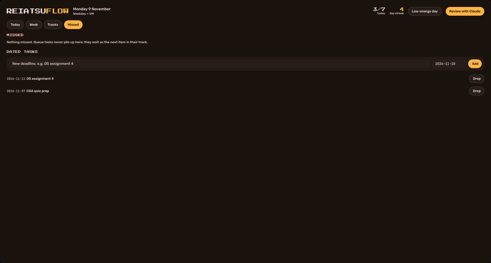

# ReiatsuFlow

A task-based study planner that lives on your Hyprland desktop. It turns long lists (a video course,
a DSA problem sheet, a semester syllabus, project milestones) into a few concrete tasks each day,
keeps you on pace for your deadlines, and never buries you under a pile of "missed" items.


- **Native and offline.** A [Quickshell](https://quickshell.org) window, no browser. It opens on
  workspace 1 at login and takes its colours from your wallpaper palette (matugen / end-4).
- **Task-based, not time-blocked.** Each subject is a queue. Every day takes the next chunk from each:
  "2 DSA problems", "~40 minutes of lectures", "3 OS topics".
- **Skipping is not failing.** An unfinished queue task simply stays first in line tomorrow. Only
  *dated* tasks (assignments, bookings) can be missed, and they roll over at most 3 times before
  being archived.
- **One honest number per track.** "Semester: 2.5 days behind for 6 Dec". Tracks with a close
  deadline borrow a slot from a flexible track when they fall behind.
- **Low-energy days.** One button shrinks today to the smallest task per track. After three empty
  days in a row, the next day becomes a low-energy day automatically: a restart, not a backlog.
- **Pomodoro** on any task, kept in the data files so it survives closing the window.
- **Evening review with Claude.** The evening notification has a "Review with Claude" button that
  opens [Claude Code](https://claude.com/claude-code) in your data folder with review instructions
  (`review/CLAUDE.md`): it goes through what's left, records project progress and resume points, and
  sorts out missed deadlines through the `rf` CLI.

| Week | Tracks | Missed |
|---|---|---|
|  |  |  |

## How it works

```
sources/*.md|json ──rf build──► tracks/<id>.json  (queues of items, with progress)
                                       │
config.json schedule ──rf status──► days/<date>.json  (today's tasks)  ◄── UI · CLI · Claude
                                       │
                               state.json · log.jsonl  (dated tasks, pomodoro, history)
```

Everything goes through one small CLI, `rf` (Python 3, standard library only). The Quickshell UI
calls `rf status --json` to read and `rf done …`, `rf pomo …` etc. to act, and watches the data files,
so changes made from a terminal or during a review show up live. A file lock keeps concurrent
`rf` calls from overwriting each other.

## Install

Requirements: Python 3.10+, Quickshell, `notify-send`, a terminal (kitty by default), optionally
Claude Code for reviews.

```sh
git clone https://github.com/J-J22/reiatsuflow ~/Projects/reiatsuflow
cd ~/Projects/reiatsuflow && ./install.sh
qs -c reiatsuflow
```

`install.sh` links `rf` into `~/.local/bin` and the UI into `~/.config/quickshell/reiatsuflow`,
copies `config.example.json` to `~/.config/reiatsuflow/config.json` if you don't have one, builds
the tracks, and installs two systemd user timers for the notifications. To open the window on
workspace 1 at login (Hyprland Lua config):

```lua
hl.on("hyprland.start", function () hl.exec_cmd("qs -c reiatsuflow") end)
hl.window_rule({match = {title = "^(ReiatsuFlow)$"}, workspace = "1 silent"})
```

Classic `hyprland.conf`: `exec-once = qs -c reiatsuflow` and
`windowrule = workspace 1 silent, title:^(ReiatsuFlow)$`.

Try it without touching your own data: `rf --config examples/config.json init`, then
`rf --config examples/config.json status`.

## Configuration

Everything is in `~/.config/reiatsuflow/config.json` (`rf paths` prints where). After changing
tracks or sources run `rf build`; after changing the schedule run `rf replan`; after changing
notification times run `rf timers`.

| Key | Meaning |
|---|---|
| `data_dir` | Where tracks, days and state live. Source lists go in `<data_dir>/sources/`. |
| `start` | Nothing is planned before this date. |
| `day_starts_at` | Hour the day rolls over (default 4, so late-night work counts for the evening before). |
| `notify` | `{"morning": "08:00", "evening": "21:30"}`, one systemd timer each. |
| `pomodoro` | `work`, `short_break`, `long_break` minutes and `long_every` pomodoros. |
| `tracks` | One entry per subject, see below. |
| `schedule` | Rules, first match wins. Each has `days` (`"all"` or `["mon", …]`), optional `from` / `to` dates, a `load` (`{"track": tasks per day}`) and `fixed` routine tasks. |
| `rebalance` | `behind_days` (default 2) and `donor` track: a deadline track that falls this far behind takes a slot from the donor (never below the donor's `min`). |
| `auto_low_after` | Empty days in a row before an automatic low-energy day (0 turns it off). |
| `missed_max_rolls` | Days a missed dated task stays before it's archived. |

A track:

```jsonc
"saa": {
  "name": "AWS SAA", "color": "#ff9f43",
  "kind": "queue",                      // or "project": one milestone at a time, with % and resume point
  "source": "sources/course.md", "format": "lectures-md",
  "chunk": { "by": "size", "target": 40, "stop_at_group": true },
  "deadline": "2027-01-10",             // pace is measured against this
  "until": "2026-12-01",                // track switches off after this date
  "skip": ["on Windows"],               // items whose title contains this start as skipped
  "revise": "re-read notes, solve PYQs" // when the queue is empty, rotate revision blocks per unit
}
```

`chunk.by` is `count` (items), `size` (minutes, for lecture lists) or `weight` (topics weighted
Quick 0.5 · Exam 1 · Go deep 1.5). `rotate: "tag"` alternates subjects inside one track; `stop_at_group`
keeps a chunk inside one section or unit. A queue can also `unlock` items only after a section of
another track is done (labs after the matching lectures) and fall back to another track when nothing
is unlocked.

### Source formats

| `format` | Shape |
|---|---|
| `roadmap-md` | `## Section`, then `Category : a, b, c`. `Theory` lines become reading items; `Hard` is tagged. |
| `lectures-md` | `## Section`, then `Lecture title \| mm:ss` (or `\| quiz`). |
| `topics-json` | `{"topics": [{"s": "OS", "u": 1, "unit": "…", "n": "1.1", "t": "…", "tag": "Exam"}], "try": {"OS.1": "…"}}`. With `"wrapups": true` each unit ends with a "Try it + PYQs" item. |
| `milestones-md` | `## Project`, then `- M1 milestone`. |
| `labs-md` | `### S1 — Title (Week 3) · cost` headings, filtered by `include`. |

Examples of each are in [`examples/sources`](examples/sources). Ids come from the content, so
editing a list and running `rf build` keeps your progress.

## CLI

```
rf status [--json]               today's tasks (ids in brackets)
rf done <task> [item…]           tick a task, or some of its items
rf undo <task> [item…]
rf low on|off                    low-energy day
rf progress <track> --pct 40 --resume "next step" [--done]
rf add "OS assignment 4" --due 2026-11-20
rf missed [<id> redo|move <date>|drop]
rf pomo start <task> | stop
rf skip <item>                   take an item out of its queue
rf replan · rf build · rf timers · rf review · rf paths
```

UI keys: `1`–`4` switch tabs, `r` refreshes. `qs ipc call reiatsuflow tab 2` works from scripts.

## Privacy

Your data folder never goes into this repo. The planner code is generic; your lists, progress and
history stay in `data_dir`.

## Tests

```sh
python3 -m unittest discover -s tests -t .
```

MIT licensed.
