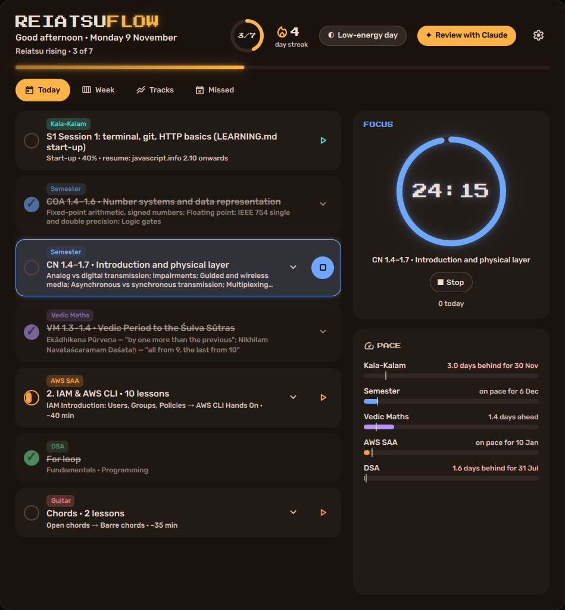
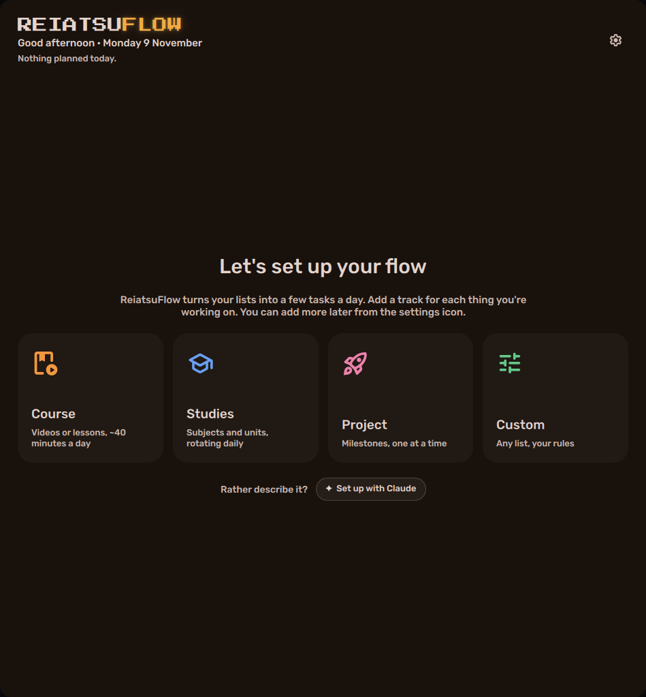
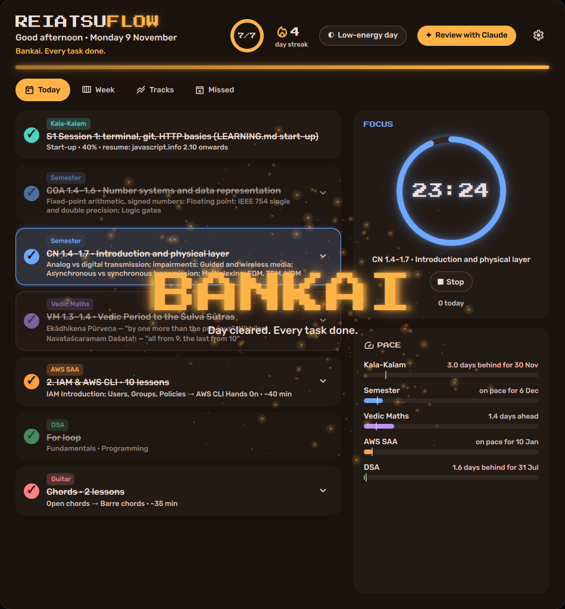
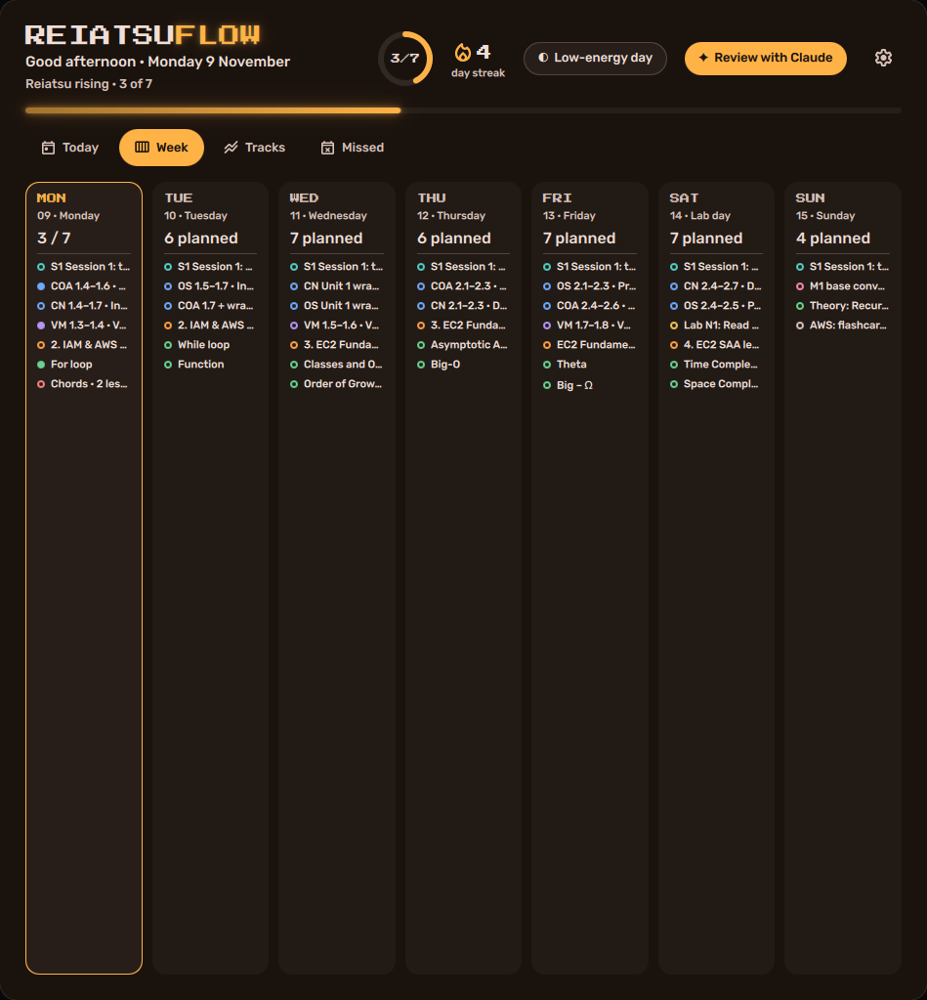
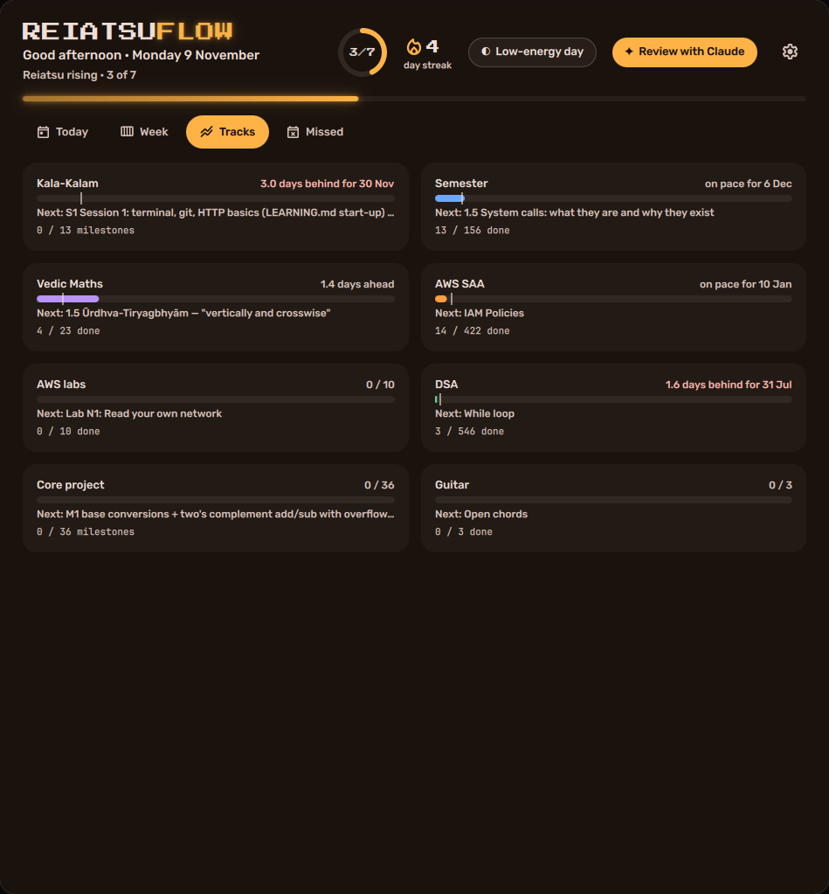
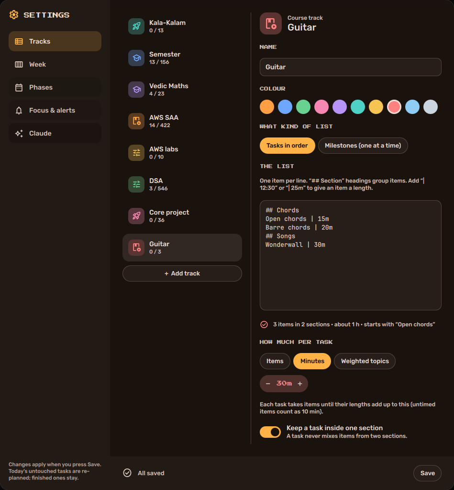
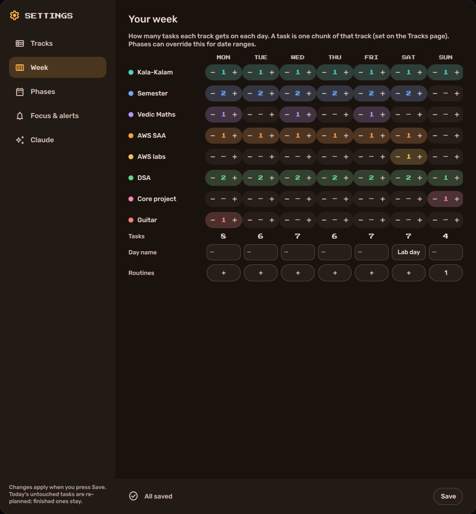

# ReiatsuFlow

A task-based planner that lives on your Hyprland desktop. Give it your lists (a video course, a
syllabus, a problem sheet, a project's milestones) and it hands you a few concrete tasks each day,
keeps you on pace for your deadlines, and never buries you under a pile of "missed" items.



- **Native and offline.** A [Quickshell](https://quickshell.org) window, no browser. Opens on
  workspace 1 at login and takes its colours from your wallpaper palette (matugen / end-4).
- **Your workflow, not a preset.** Four templates (Course, Studies, Project, Custom), each fully
  configurable, so a track can be a guitar course, a thesis or a semester as easily as a problem sheet.
- **Task-based, not time-blocked.** Each track is a queue. Every day takes the next chunk from each:
  "~40 minutes of lessons", "3 topics of one subject", "the current milestone".
- **Skipping is not failing.** An unfinished task simply stays first in line tomorrow. Only *dated*
  tasks (assignments, bookings) can be missed, and they're archived after a few days instead of piling up.
- **One honest number per track.** "Semester: 2 days behind for 6 Dec". A track with a close
  deadline can borrow a slot from a flexible one when it falls behind.
- **Low-energy days.** One button shrinks today to the smallest task per track. After three empty
  days in a row it happens by itself: a restart, not a backlog.
- **Lively.** Reiatsu sparks when you tick a task, a glowing day bar, a breathing pomodoro ring, and
  a BANKAI moment when the whole day is cleared. Animations only run when something happens.
- **Pomodoro** on any task, stored in the data files so it survives closing the window.
- **Claude, optionally.** "Set up with Claude" builds your tracks and week from a conversation;
  the evening notification's "Review with Claude" goes through the day with you. Both use
  [Claude Code](https://claude.com/claude-code) and the same `rf` commands as the app.

| First launch | Day cleared |
|---|---|
|  |  |

| Week | Tracks |
|---|---|
|  |  |

## Settings

The gear icon opens a separate Settings window. Nothing changes until you press **Save**; then the
tracks are rebuilt from their lists and today's untouched tasks are re-planned (finished ones stay).

| Tracks | Week |
|---|---|
|  |  |

- **Tracks.** Add one from a template, paste its list, and pick how big one task is: a number of
  items, a number of minutes (for lessons with lengths), or weighted topics. Options: keep a task
  inside one section, rotate between subjects, switch to revision blocks when the list is done,
  finish-by / start / end dates, pause. Changing a list later keeps your progress.
- **Week.** A grid of tasks per track per day, day names ("Lab day") and routines (fixed tasks such
  as "Weekly review").
- **Phases.** Date ranges that replace the week, e.g. "Exams: semester only, 4 a day".
- **Focus & alerts.** Notification times, pomodoro lengths, when the day rolls over, the automatic
  low-energy day, how long missed deadlines wait, and the catch-up rule.
- **Claude.** "Set up with Claude" and "Review today".

### The list format

One item per line. Headings group items; bullets and numbering are fine; a length is optional.

```
# Operating Systems          ← subject (rotated between days when “Rotate between subjects” is on)
## Unit 1: Processes         ← section
Process vs program
Process states | 25m         ← lengths: | 12:30, | 25m or | 1h
- Schedulers
```

| Template | Starts as |
|---|---|
| Course | ~40 minutes of lessons per task, never crossing a section |
| Studies | 3 topics per task, rotating subjects, revision when done |
| Project | one milestone at a time; the review records % done and where to resume |
| Custom | 2 items per task; everything else is up to you |

## Install

Requirements: Python 3.10+, Quickshell, `notify-send`, a terminal (kitty by default), optionally
Claude Code.

```sh
git clone https://github.com/J-J22/reiatsuflow ~/Projects/reiatsuflow
cd ~/Projects/reiatsuflow && ./install.sh
qs -c reiatsuflow
```

`install.sh` links `rf` into `~/.local/bin` and the UI into `~/.config/quickshell/reiatsuflow`,
creates an empty config, and installs two systemd user timers for the morning and evening
notifications. To open the window on workspace 1 at login (Hyprland Lua config):

```lua
hl.on("hyprland.start", function () hl.exec_cmd("qs -c reiatsuflow") end)
hl.window_rule({match = {title = "^(ReiatsuFlow)$"}, workspace = "1 silent"})
hl.window_rule({match = {title = "^(ReiatsuFlow Settings)$"}, float = true, size = {1060, 760}, center = true})
```

Classic `hyprland.conf`: `exec-once = qs -c reiatsuflow`,
`windowrule = workspace 1 silent, title:^(ReiatsuFlow)$` and
`windowrule = float, title:^(ReiatsuFlow Settings)$`.

Keys: `1`–`4` switch tabs, `,` opens Settings, `r` refreshes. From scripts:
`qs -c reiatsuflow ipc call reiatsuflow tab 2`, `… settings`.

## How it works

```
your lists ──rf build──► tracks/<id>.json   (queues of items, with progress)
                                │
week · phases ──rf status──► days/<date>.json   (today's tasks)   ◄── UI · CLI · Claude
                                │
                        state.json · log.jsonl   (dated tasks, pomodoro, history)
```

Everything goes through one small CLI, `rf` (Python 3, standard library only). The UI calls
`rf status --json` to read and `rf done …`, `rf pomo …`, `rf config save …` to act, and watches the
data files, so changes made from a terminal or during a Claude review show up live. A file lock
keeps concurrent `rf` calls from overwriting each other.

The config lives at `~/.config/reiatsuflow/config.json` (`rf paths` prints where). It's what the
Settings window edits, so editing it by hand works too: run `rf build` after changing tracks and
`rf replan` after changing the week. Besides the simple list format, `format` can read a few richer
sources (`lectures-md`, `roadmap-md`, `topics-json`, `labs-md`, `milestones-md`); see
[`examples/`](examples) and `rf/sources.py`.

### CLI

```
rf status [--json]               today's tasks (ids in brackets)
rf done <task> [item…]           tick a task, or some of its items
rf undo <task> [item…]
rf low on|off                    low-energy day
rf progress <track> --pct 40 --resume "next step" [--done]
rf add "OS assignment 4" --due 2026-11-20
rf missed [<id> redo|move <date>|drop]
rf pomo start <task> | stop
rf skip <item>                   take an item out of its queue
rf config get | save '<json>'    what the Settings window uses
rf source preview|save|get …
rf setup · rf review · rf replan · rf build · rf timers · rf paths
```

## Privacy

Your data folder never goes into this repo. The planner is generic; your lists, progress and
history stay on your machine in `data_dir`.

## Tests

```sh
python3 -m unittest discover -s tests -t .
```

MIT licensed.
